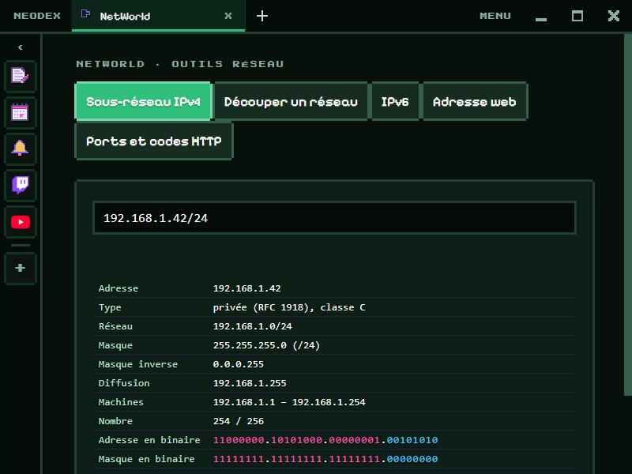

# NetWorld

The network toolbox. Everything is computed locally: nothing is sent over the network.

*Version française : [README.md](README.md)*

## IPv4 subnet

Write an address with its prefix (`192.168.1.42/24`) or its mask (`10.0.0.1 255.255.240.0`): network, mask and wildcard mask, broadcast, first and last host, address count, address type (private, public, loopback, CGNAT…) and class, and the address and mask in binary, the network part in pink and the host part in blue.

## Splitting a network (VLSM)

A starting network and, line by line, each department with its number of hosts (`Bureaux 200`). The biggest are placed first, each in the smallest block that fits (a /30 at the smallest). A table gives each subnet, its range, its broadcast and the free addresses, and a bar shows the space used.

## IPv6

Expanded and compressed form (the longest run of zeros becomes `::`), address type (global, link-local, unique local…), the network when a prefix is given, and the reverse name for DNS. IPv4-in-IPv6 addresses (`::ffff:192.0.2.1`) are understood.

## Web address

A URL broken down: protocol, user, host, port (or the default one), path, parameters one by one, anchor and origin.

## Ports and HTTP codes

40 common ports (SSH, DNS, HTTPS, RDP, Minecraft, WireGuard…) and the HTTP codes explained, with a search.

## Data

The last addresses and the last split are kept in the plugin folder. Permission: `storage` only.
