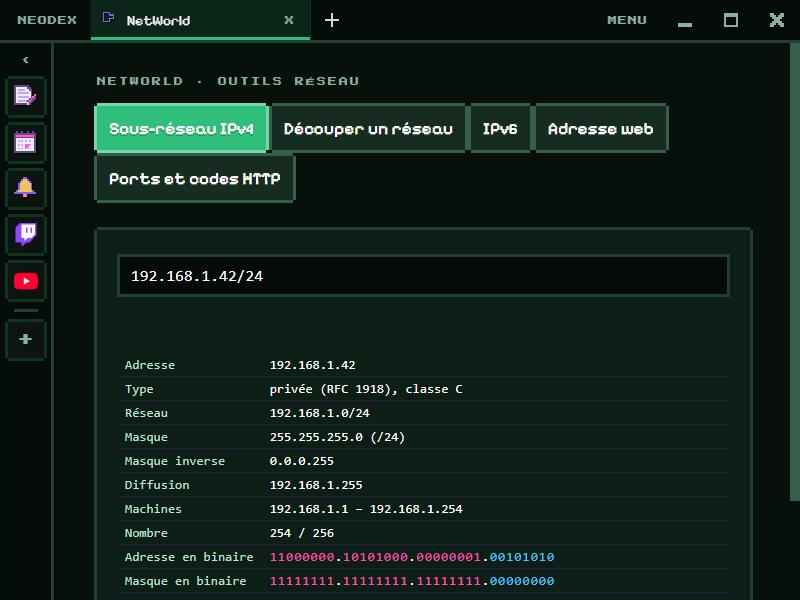

# NetWorld

La boîte à outils réseau. Tout est calculé sur place : rien n'est envoyé sur le réseau.

*English version: [README.en.md](README.en.md)*

## Sous-réseau IPv4

Écris une adresse avec son préfixe (`192.168.1.42/24`) ou son masque (`10.0.0.1 255.255.240.0`) : réseau, masque et masque inverse, diffusion, première et dernière machine, nombre d'adresses, type d'adresse (privée, publique, boucle locale, CGNAT…) et classe, et l'adresse et le masque en binaire, la partie réseau en rose et la partie machine en bleu.

## Découper un réseau (VLSM)

Un réseau de départ et, ligne par ligne, chaque service avec son nombre de machines (`Bureaux 200`). Les plus grands sont placés d'abord, chacun dans le plus petit bloc qui suffit (un /30 au plus petit). Un tableau donne chaque sous-réseau, sa plage, sa diffusion et les adresses libres, et une barre montre la place occupée.

## IPv6

Forme développée et compressée (la plus longue suite de zéros devient `::`), type d'adresse (globale, lien local, locale unique…), le réseau quand un préfixe est donné, et le nom inverse pour le DNS. Les adresses IPv4 dans IPv6 (`::ffff:192.0.2.1`) sont comprises.

## Adresse web

Une URL décomposée : protocole, utilisateur, hôte, port (ou celui par défaut), chemin, paramètres un par un, ancre et origine.

## Ports et codes HTTP

40 ports courants (SSH, DNS, HTTPS, RDP, Minecraft, WireGuard…) et les codes HTTP expliqués en français, avec une recherche.

## Données

Les dernières adresses et le dernier découpage sont gardés dans le dossier du plugin. Autorisation : `storage` seulement.
